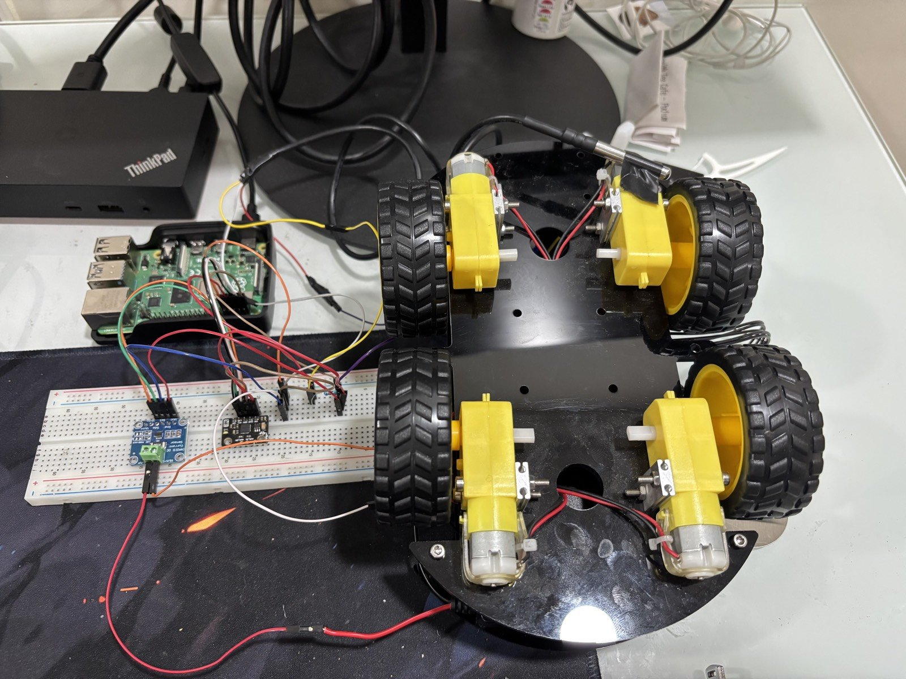
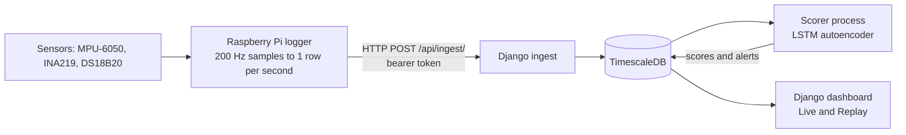
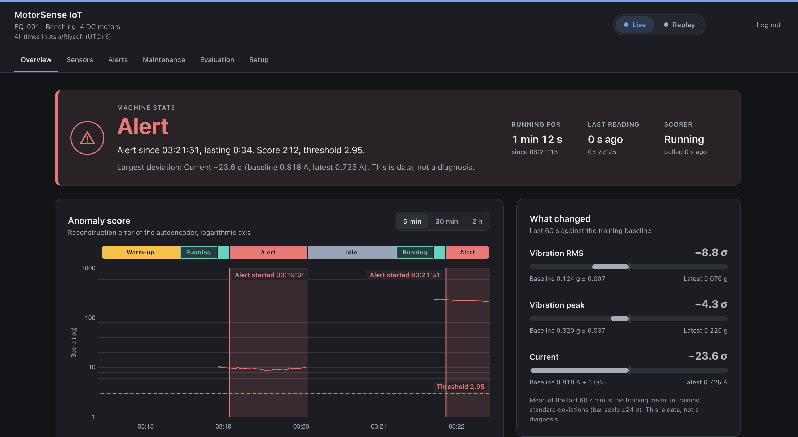

# MotorSense IoT

A Raspberry Pi reads vibration, current, pack voltage and temperature from a robot car with
four DC motors, used as a small stand-in for rotating machinery. The readings are stored in
TimescaleDB, and an LSTM autoencoder scores them once per second. A Django dashboard shows the
machine state, the score and alerts, either live or as a replay of a recorded session.

## What this is and is not

This is a small bench project. One fault type was tested: one motor lead disconnected. The
test set is one normal session and three fault sessions from the same rig. It is not a
validated product, and nothing here is claimed beyond this bench rig.



*Testbed with tyres fitted. All recordings were made with the wheels removed.*



## Results

From `results/metrics.json`. Test sessions: r5_normal_05 (normal) and r5_fault_open_01, 02
and 03 (one motor lead disconnected); 450 scored seconds each. The threshold of every detector
is the 99.5th percentile of its scores on the validation session r5_normal_04_redo, and an alert
fires on the 10th consecutive second above it. Autoencoder cells give the mean over seeds 0 to
4 and, where the seeds differ, the range.

<!-- results-table:start -->
| Detector | Seeds | Fault sessions alerted (of 3) | Alerts on the normal test session | Mean delay to the first alert (s) | Per-second recall | False-positive seconds on the normal test session |
|---|---|---|---|---|---|---|
| LSTM autoencoder, all three features | 5 | 3 | 0 | 9 | 1 | 0 |
| LSTM autoencoder, vibration only | 5 | 2.2 (2 to 3) | 0 | 218.8 (197 to 248) | 0.22 (0.179 to 0.29) | 0 |
| LSTM autoencoder, current only | 5 | 3 | 0 | 9 | 1 | 0 |
| Fixed threshold on the current z-score | none (no training) | 3 | 0 | 9 | 1 | 14 |
| Fixed threshold on the vibration RMS z-score | none (no training) | 1 | 0 | 350 | 0.299 | 7 |
<!-- results-table:end -->

The table is generated by `python -m dashboard.ml.render_readme_results`; a test fails if it
differs from this copy.

- The three-feature autoencoder alerted on all 3 held-out fault sessions and did not alert on
  the held-out normal session. Each alert fired 9 s after the first scored second, which is the
  earliest the 10-second rule allows, because the fault was present from the start.
- A fixed threshold on current did equally well per session: 3 of 3 fault sessions, no alert on
  the normal session, 9 s. Per second it had 14 false-positive seconds on the normal session,
  which did not become an alert.
- Vibration alone detected the fault only partly: the vibration-only autoencoder alerted on 2
  to 3 of 3 fault sessions depending on the seed, with a per-second recall of 0.22.
- The test set is one normal and three fault sessions of one fault type on one rig. They are
  not independent trials.

The full tables, the seed spread and the score of each session are on the dashboard's
Evaluation tab. The plan, written before training, is in
[docs/evaluation_plan.md](docs/evaluation_plan.md).

## Negative findings

From `results/negative_findings.json` (`python analysis/negative_findings.py`). Vibration is
compared only between runs in the same phase, and against the spread between the five normal
sessions: 11.5 % for vibration RMS, 13.5 % for vibration peak and 1.1 % for current.

- **Imbalance and loose mounting:** three imbalance runs (taped weights) and one loose-mount run, each against its like-for-like reference. 3 of the 8 RMS and peak values are above the spread:
  - r3_test_fault (imbalance): RMS +16.8 % and peak +19.1 %, both above the spread.
  - r3_test_fault2 (imbalance): RMS +8.4 % and peak +10.7 %, both within it.
  - r4_band_fault_a (imbalance): RMS +0.3 % and peak +2.6 %, both within it.
  - r3_test_loose (loose mount): RMS +8.2 % within it, peak +15.0 % above it.
- **Friction by hand:** it raised the current by 0.9 % and 0.7 %, within its 1.1 % spread. Its 60 s runs are too short for a like-for-like vibration comparison.
- **Frequency bands:** the four bands changed by -7.1 % to +6.4 % between an imbalance run and its reference, in both directions and within the band spreads (10.3 % to 36.7 %), so they did not separate the imbalance.
- **Handling the rig:** the mechanical handling shifted the normal baseline of vibration RMS by 23.2 % (vibration peak 31.3 %) with no fault applied.

With one to three short runs per fault and a baseline that moves this much, none of these faults
could be evaluated reliably. This is why the evaluation is limited to the open motor lead,
which dropped the current by 14.6 %.

## Live demonstration on the real rig (23 Oct 2026)

The logger ran on the rig with the run label `live_demo`, and the scorer ran against the
database. These are single demonstration runs and not part of the evaluation. Times are
Asia/Riyadh (UTC+3). Captions and all screenshots are in
[docs/screenshots/live_rig/](docs/screenshots/live_rig/README.md).

1. **02:53** Warming up after the motors started (`live_rig_warmup.png`); at 02:56 running, with scoring starting once 30 s are buffered (`live_rig_running.png`); then Normal at a score of 0.609 against the threshold 2.95 (`live_rig_normal.png`).
2. **02:59:25 False alarm** (21 s, peak score 5.03; `live_rig_false_alarm.png`, `live_rig_sensors.png`). One second had a vibration peak of 1.0214 g while the vibration RMS was 0.1475 g, with no I2C errors in that second. This is probably a single bad sample out of 200; the cause is not established.
   - **The weakness it shows:** a one-second outlier stays inside the 30-second scoring window for about 30 s. That is long enough to pass the 10-second rule.
3. **03:15** Idle before the next run (`live_rig_idle.png`).
4. **03:19:04 Unexplained alert** (1 min 00 s, score about 9 to 10). It came during handling of the rig; the cause was not recorded.
5. **03:21:39 Motor lead disconnected** (`live_rig_after_disconnect.png`). Current at -96.9 sigma in the last 60 s, before the new sequence was scored.
6. **03:21:51 Alert** (`live_rig_alert.png`): score 212 against 2.95, largest deviation current at -23.6 sigma (baseline 0.818 A, latest 0.725 A).
7. **Alerts tab** with the three episodes (`live_rig_alerts_tab.png`).



## Screenshots

"Live, fed from a recording" means the live code path was fed recorded rows through the
ingest endpoint for the screenshot; it is not a live measurement. Details are in
[docs/screenshots/](docs/screenshots/README.md).

| Screenshot | What it shows |
|---|---|
| [Overview, replay of r5_fault_open_01](docs/screenshots/replay_fault_open_01_alert_1440.png) | Replay of a recorded fault session at the second the first alert fires |
| [Overview, replay of r5_normal_05](docs/screenshots/replay_normal_05_1440.png) | Replay of the recorded normal test session, no alert |
| [Overview, running](docs/screenshots/live_running_1440.png) | Live, fed from a recording: state Normal, scores below the threshold |
| [Overview, alert](docs/screenshots/overview_live_alert_1440.png) | Live, fed from a recording: an alert from a recorded fault session |
| [Sensors](docs/screenshots/sensors_1440.png) | Live, fed from a recording: trend charts, minimum, mean, maximum and data quality |
| [Alerts](docs/screenshots/alerts_1440.png) | Live, fed from a recording: the alert table with one alert opened |
| [Maintenance](docs/screenshots/maintenance_1440.png) | Live, fed from a recording: operator log with a fixture entry, next inspection set by the operator |
| [Evaluation](docs/screenshots/evaluation_1440.png) | The result files: caveat, tables, negative findings; recorded sessions only |
| [Setup](docs/screenshots/setup_1440.png) | Testbed, pipeline, model inputs, alert rule and limitations |

## Quick start without hardware

These steps were tested on macOS arm64 with Python 3.10.13, starting from a fresh clone. You need
Python 3.10 and Docker. Run every command from the repository root.

1. Install:
   ```
   python3.10 -m venv venv
   source venv/bin/activate
   pip install -r requirements.txt -c constraints-macos-arm64-py310.txt
   pip install -r requirements-ml.txt -c constraints-macos-arm64-py310.txt
   ```
   The constraints file pins every package to the versions that produced the results. On other
   platforms leave it out; `requirements-ml.txt` then needs a different TensorFlow package (see
   the note in that file).
2. Copy `.env.example` to `.env` and set `SECRET_KEY`, `INGEST_TOKEN` and `DB_PASSWORD`; the file
   shows how to generate the first two.
3. Start TimescaleDB with `docker compose up -d`. This creates the container
   `motorsense_timescaledb` on port 5432. If that name or port is taken, run the image
   `timescale/timescaledb:latest-pg15` under another name and port and set `DB_PORT` in `.env`.
4. Set up the database, a login and the data:
   ```
   python manage.py migrate
   python manage.py setup_timescaledb
   python manage.py createsuperuser
   python manage.py import_recordings
   python manage.py replay_session --label r5_normal_04_redo --label r5_normal_05 \
       --label r5_fault_open_01 --label r5_fault_open_02 --label r5_fault_open_03
   python manage.py runserver
   ```
5. Open http://127.0.0.1:8000/, log in and switch to **Replay** in the header.

`import_recordings` loads the evaluation sessions and their warm-up rows from
`data/recordings/`. To check the replays against the evaluation:

```
python manage.py export_dataset
python analysis/compare_replay_to_evaluation.py
python analysis/compare_replay_scores.py
```

Both scripts exit with code 1 on a mismatch. Tests: `python manage.py test`.

## Running it with the rig

- **The Pi:** the logger, the wiring and the Pi setup are described in [testbed/README.md](testbed/README.md).
- **Ingest token:** the Pi posts each row to `/api/ingest/` with `Authorization: Bearer <token>`, and the token must equal `INGEST_TOKEN` in the dashboard's `.env`. The first reading creates the equipment EQ-001.
- **Scorer:** start it in a second terminal with `python manage.py score_live --equipment EQ-001`. It uses the saved model in `models/motorsense_ae/`, and on its first start it begins at the newest reading. The dashboard's Live mode then shows the state, the score and alerts.
- **Data retention:** raw readings older than 30 days are dropped by the retention policy that `setup_timescaledb` adds.

## Reproducing the evaluation

| Step | Command | Output |
|---|---|---|
| Load the recorded sessions | `python manage.py import_recordings` | `sensor_data` rows from `data/recordings/raw/` |
| Export the dataset | `python manage.py export_dataset` | `data/dataset/` (not committed) |
| Train and evaluate every detector | `python -m dashboard.ml.run_evaluation` | `results/metrics.json`, `results/scores/` (not committed), and the seed-0 model in `models/motorsense_ae/` |
| Negative findings | `python analysis/negative_findings.py` | `results/negative_findings.json` |

The evaluation read the rows that reached the database, not every logged row. Rows missing
from the database are listed in `data/recordings/not_in_database.csv`, and `import_recordings`
leaves them out by default. More commands are in [docs/README.md](docs/README.md).

## Repository layout

| Path | Content |
|---|---|
| `dashboard/` | Django app: models, ingest endpoint, JSON API, pages, scorer service |
| `dashboard/ml/` | Dataset roles, evaluation, live scoring core, README table |
| `monitor/` | Django settings |
| `analysis/` | Negative findings and replay comparison scripts |
| `data/recordings/` | Published recordings, session table, rows not in the database |
| `models/motorsense_ae/` | Saved seed-0 model, scaler and threshold |
| `results/` | `metrics.json`, `negative_findings.json` |
| `testbed/` | Logger for the Raspberry Pi and the rig's wiring |
| `docs/` | Evaluation plan, how to reproduce, screenshots, testbed photo |

## Limitations

- **Ingest security:** readings travel over plain HTTP without TLS on a home network, so the bearer token is sent in clear text.
- **Current:** it is not calibrated against a reference meter.
- **Vibration sensor mounting:** the MPU-6050 sits on a breadboard that rests on the chassis and is not rigidly fixed.
- **Baseline drift:** the vibration baseline shifts after the rig is handled (23.2 % in vibration RMS).
- **Faults and data:** one fault type was tested, and the test set is small (one normal and three fault sessions).
- **Invalid session:** r5_normal_04 is invalid, and its cause is unknown.
- **False alarms:** one bad vibration sample can raise an alert, because it stays in the 30-second window.
- **I2C read errors:** a few occur per session normally, and hundreds when the rig is disturbed.
- **Platforms:** the ML part was tested only on macOS arm64 with Python 3.10.13, and the logger only on the Raspberry Pi 4 described in `testbed/README.md`.

## What I would improve next

- A robust peak, for example a median filter or a high percentile instead of the maximum of 200 samples.
- More fault types and longer sessions.
- Calibrating the current against a reference meter.
- TLS on the ingest endpoint.
- Retraining on more sessions.
- Alert hysteresis, so that a short outlier does not open an alert.

## History

This repository started as a prototype with simulated turbine data and an unvalidated
accuracy figure. That part was removed, and no accuracy figure from it is claimed anywhere.
